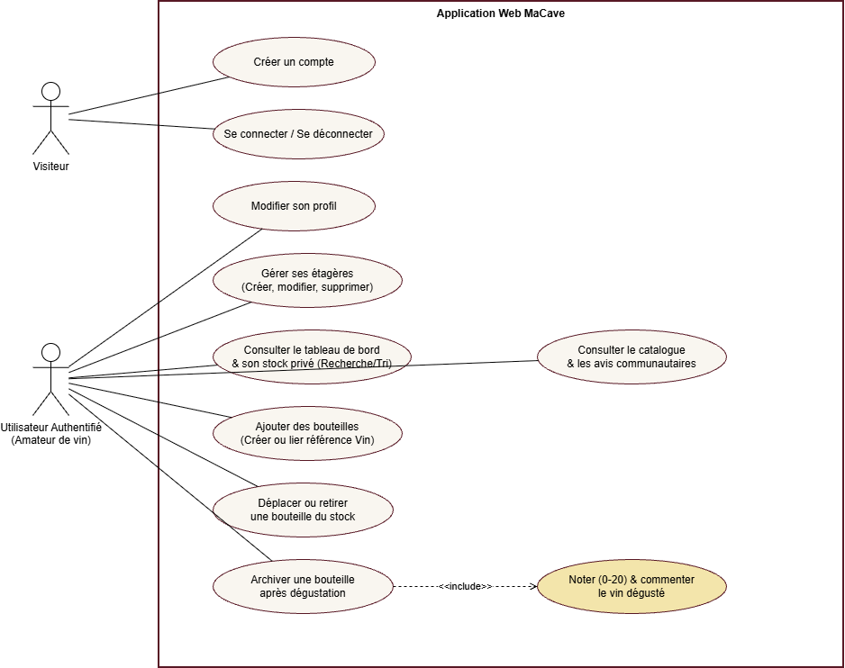
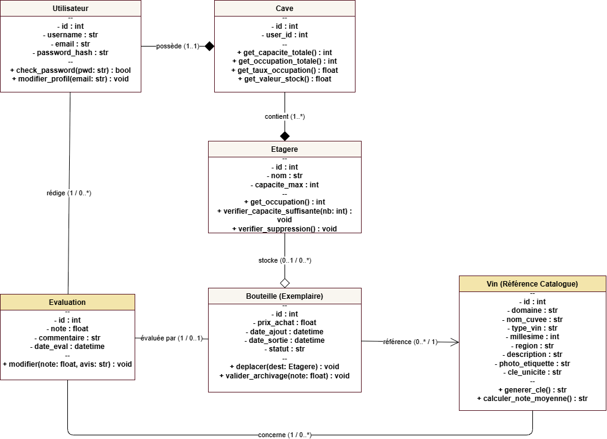
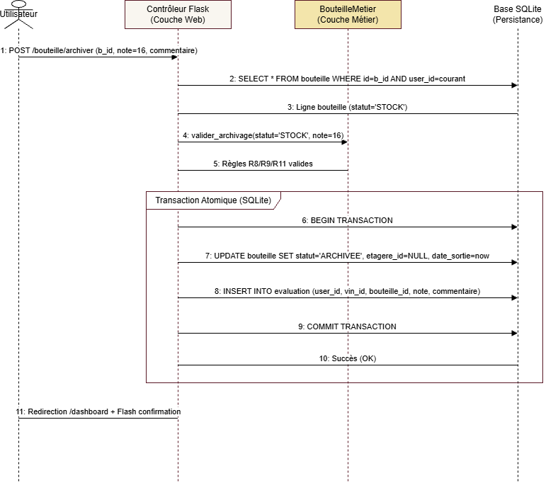
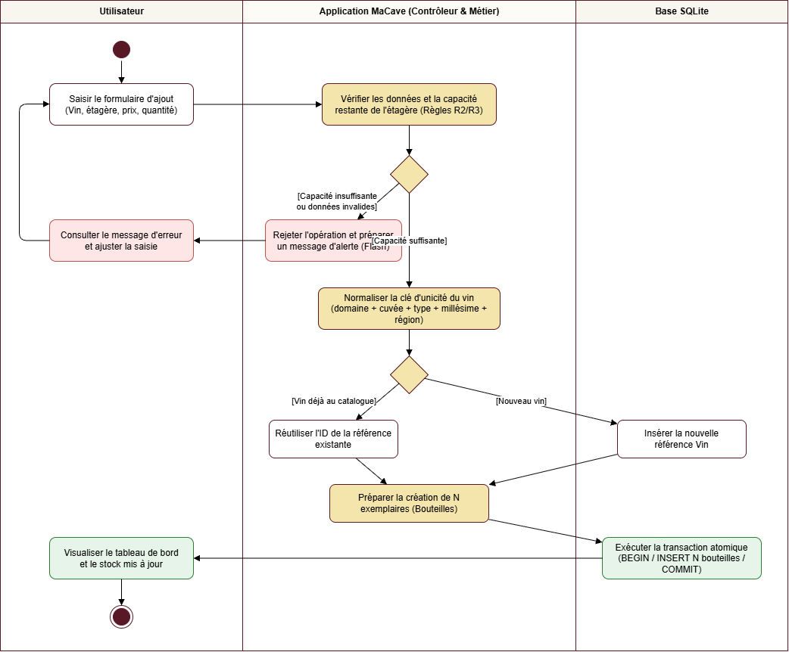

# 🍷 MaCave — Gestionnaire Collaboratif de Cave à Vin

**MaCave** est une application web multi-utilisateurs développée avec Python, Flask et SQLite. Elle permet aux amateurs de vin de gérer leur cave privée, d'organiser leurs bouteilles sur des étagères virtuelles, de suivre leur historique de dégustation et de partager leurs évaluations au sein d'une communauté.

---

## 📑 Sommaire

1. [Présentation du Projet](#-présentation-du-projet)
2. [Architecture & Technologies](#️-architecture--technologies)
3. [Modélisation UML](#-modélisation-uml)
4. [Installation et Démarrage Local](#-installation-et-démarrage-local)
5. [Perspectives & Évolutions Futures](#-perspectives--évolutions-futures)

---

## 📌 Présentation du Projet

L'application résout la problématique de la gestion physique et qualitative du vin au quotidien en proposant une séparation stricte entre **l'espace privé** (stock, emplacements, prix d'achat) et **l'espace communautaire** (catalogue partagé, notes et commentaires).

### Fonctionnalités & Règles Métier
- 🔒 **Confidentialité & Étanchéité :** Chaque utilisateur accède uniquement à son propre stock privé et à ses étagères. Les données financières et les emplacements physiques restent strictement personnels.
- 📐 **Distinction Référence vs Exemplaire physique :** Une référence de vin (`Vin`) est unique au catalogue collectif (évitant les doublons grâce à un nettoyage normalisé de la casse et des espaces). Une bouteille (`Bouteille`) représente l'exemplaire physique réel possédant son propre prix, sa date d'entrée et son étagère.
- 📦 **Gestion fine des étagères :** Contrôle dynamique de la capacité. Impossible de surcharger une étagère ou de supprimer une étagère non vide.
- ⚛️ **Atomicité des opérations :** Toutes les opérations de stock (ajout, déplacement, archivage) sont transactionnelles (`BEGIN` / `COMMIT` / `ROLLBACK`), empêchant tout état partiel en base de données.
- 🍷 **Dégustation & Archivage :** Lorsqu'une bouteille est dégustée, elle quitte l'étagère pour intégrer l'historique privé avec une note sur 20 et un commentaire facultatif.
- ⭐ **Moyenne communautaire dynamique :** Le catalogue calcule à la volée la note globale de chaque référence. Si aucune évaluation n'est encore enregistrée, la mention *« Non évalué »* est affichée.

## 📊 Modélisation UML

Les fichiers sources modifiables (compatibles avec [draw.io](https://app.diagrams.net/)) ainsi que leurs exports visuels sont disponibles dans le répertoire [`docs/`](docs/)[cite: 2, 3].

### 1. Diagramme de Cas d'Utilisation

*Source éditable : [`docs/1_diagramme_cas_utilisation.drawio`](docs/1_diagramme_cas_utilisation.drawio)*[cite: 2]

### 2. Diagramme de Classes Métier

*Source éditable : [`docs/2_diagramme_classes.drawio`](docs/2_diagramme_classes.drawio)*[cite: 2]

### 3. Diagramme de Séquence (Archivage & Dégustation)

*Source éditable : [`docs/3_diagramme_sequence.drawio`](docs/3_diagramme_sequence.drawio)*[cite: 2]

### 4. Diagramme d'Activité (Ajout de bouteilles en stock)

*Source éditable : [`docs/4_diagramme_activite.drawio`](docs/4_diagramme_activite.drawio)*[cite: 3]

## 🛠️ Architecture & Technologies

Le projet suit une architecture modulaire en couches, garantissant un découplage total entre l'interface HTTP et la logique métier.

- **Langage & Framework Web :** Python 3, Flask
- **Moteur de Template & Design :** Jinja2, HTML5 / CSS3 (Thème personnalisé *Bordeaux & Chêne*)
- **Base de Données :** SQLite avec gestion des clés étrangères (`PRAGMA foreign_keys = ON;`) et contraintes d'intégrité
- **Validation & Sécurité :** Hachage des mots de passe (`Werkzeug`), contrôles d'accès côté serveur
- **Tests unitaires :** `pytest`

### Structure du dépôt

```text
macave/
├── app.py                  # Contrôleur Flask & Routes HTTP
├── database.py             # Gestionnaire de connexions et transactions SQLite
├── schema.sql              # Modèle relationnel DDL
├── models/                 # Couche Métier découpée (POO)
│   ├── vin.py              # Catalogue, unicité et moyennes
│   ├── etagere.py          # Validation des capacités et suppressions
│   └── bouteille.py        # Cycle de vie et règles d'archivage
├── templates/              # Vues Jinja2 (base, dashboard, catalogue, etc.)
├── static/                 # Fichier de style (style.css)
├── tests/                  # Tests automatisés (pytest)
├── docs/                   # Diagrammes UML (sources .drawio & exports .png)
├── requirements.txt
└── README.md